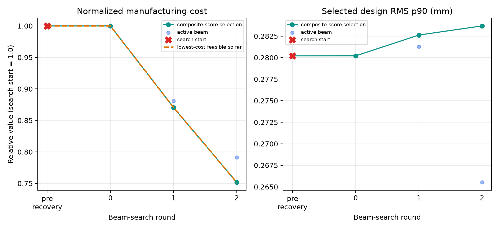

# Manufacturing-aware differentiable lens design

Material search and differentiable optical refinement with manufacturing-error
sampling and relative accepted-unit cost objectives, built on DeepLens.

[中文说明](README_zh.md) · [Method](docs/METHOD.md) · [Data](docs/DATA.md)

## Status
Local source release candidate. No GitHub upload or public release has been made.
The self-contained short demonstration uses synthetic materials and costs.
It is a software demonstration, not a reproduction of the projection-lens paper.
Paper configuration templates require separately supplied authorized data.


This short run shows cost/RMS tradeoffs, not simultaneous improvement of all
metrics. With only eight tolerance samples it is not a yield study.

## Installation
Python 3.12 or later is recommended. Create an isolated environment. Install a
compatible PyTorch/torchvision CPU or CUDA pair following https://pytorch.org/get-started/locally/
Then run:

```powershell
python -m pip install -r requirements.txt
python run.py --config configs/demo_search.yml --check
python run.py --config configs/demo_search.yml
```

For Linux/macOS use the same Python commands. The runner uses the active Python
interpreter and sets its working directory to this repository. It does not
download pretrained models or change your CUDA installation. Some optional
upstream modules have further dependencies outside this manufacturing workflow.

## Configuration and progress
The demo uses two rounds, two candidates per round and three recovery/refinement
steps per candidate. These small budgets do not demonstrate convergence.
Change `search.max_rounds`, `max_trials_per_round`, `beam_width`,
`nominal_steps_per_trial`, `robust_steps_per_trial`, and `evaluation_trials` to
increase effort. `device: auto` uses CUDA when available, otherwise CPU.
The English progress display and stdout logs are integrated in the runner.
Ctrl+C terminates the foreground search; completed stages remain reusable.

```powershell
python run.py --config configs/demo_search.yml --no-monitor
python run.py --config configs/demo_search.yml --replot-only
```

See `results/demo_search/` for reports, selected lens JSON, cost/RMS plots and
search history. The independent MTF diagnostic is disabled in the short demo.
Paper settings live in `configs/paper/`; see docs/DATA.md before running them.

After all four paper ablation searches are complete, evaluate them with common
samples and bootstrap the saved Q90 differences:

```powershell
python tools/evaluate_paper_ablations.py
```

The source package was smoke-tested in the author's existing Python 3.14.6 /
PyTorch 2.14.0+cu126 environment on an RTX 3060. A fresh installation and full
paper rerun have not yet been tested for this release candidate.

## Scientific scope
Relative cost is not a currency quotation. Simulated pass fractions are not
measured production yields. Optical-parameter gradients and outer material search
have distinct roles. Definitions and model assumptions are in docs/METHOD.md.

## Attribution and citation
DeepLens: https://github.com/singer-yang/DeepLens
AutoLens: https://github.com/vccimaging/AutoLens
Preserve original source notices; cite the upstream software and relevant paper.
Associated manuscript: 面向量产的投影镜头可微设计：制造良率与成本协同优化
Author: Taiyuange Lou. Intended repository: https://github.com/yogurt-lt/manufacturing-aware-lens-design
The repository has not yet been published. Publication DOI will be added when available.
Apache-2.0 applies to code; third-party data permissions are separate. See NOTICE.
